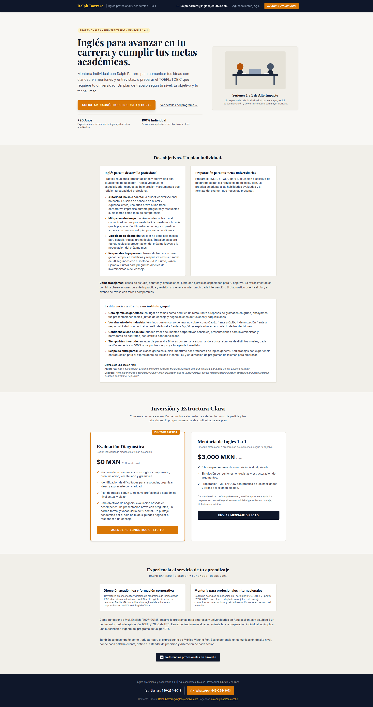

# DESIGN.md: inglesejecutivo.com

## Source

- URL: https://inglesejecutivo.com/
- Capture date: 2026-10-14
- Evidence: full-page screenshot (`.firecrawl/source-fullpage.png`), raw HTML (Tailwind v3 CDN classes + inline `<style>` custom `sand` palette), branding scrape, `links` scrape, full-page accessibility snapshot.
- Original stack: static single-page HTML, `cdn.tailwindcss.com` (Tailwind v3 preflight), Google Fonts (Inter + Playfair Display), Netlify-hosted. **No external images** — the hero illustration is inline SVG; every visual is CSS/SVG. The whole page is therefore exactly reproducible from Tailwind classes + tokens.

## Reference Screenshot

Use this as the visual source of truth for layout, hierarchy, density and feel. Tokens below describe the same page in machine-readable form.

## Design Summary

A calm, editorial one-pager for a 1-on-1 business/academic English coach. Light "paper" background with warm sand surfaces, deep slate text, a single amber accent used for CTAs, checkmarks and the header wordmark. Serif headings (Playfair Display) over a sans body (Inter). Sticky dark contact bar on top, alternating full-width sand/sandless sections, two-column card grids that collapse to one column on mobile. Understated, professional, high-contrast CTAs.

## Design Tokens

### Colors

Observed from raw CSS (`tailwind` default palette + custom `sand`). Tailwind names in parens.

| Role                   | Token                     | Hex                   | Tailwind class seen                           |
| ---------------------- | ------------------------- | --------------------- | --------------------------------------------- |
| Page background        | `bg-sand-100`             | `#f8f7f4`             | body / `.bg-sand-100`                         |
| Section surface (alt)  | `bg-sand-200`             | `#f1efe9`             | `.bg-sand-200`                                |
| Card/border on sand    | `border-sand-300`         | `#e5e2d8`             | `.border-sand-300`                            |
| Dark header/footer     | `slate-900`               | `#0f172a`             | `.bg-slate-900`                               |
| Dark hover             | `slate-800`               | `#1e293b`             | `.hover:bg-slate-800`                         |
| Primary text           | slate-800/900             | `#1e293b` / `#0f172a` | body `color:rgb(30,41,59)`, `.text-slate-900` |
| Muted text             | `slate-600/700`           | `#475569` / `#334155` | `.text-slate-700`                             |
| Subtle text            | `slate-500/400`           | `#64748b` / `#94a3b8` | `.text-slate-500`, footer `.text-slate-400`   |
| Accent / CTA fill      | `amber-600`               | `#d97706`             | `.bg-amber-600`                               |
| Accent hover           | `amber-700`               | `#b45309`             | `.hover:bg-amber-700`                         |
| Accent on dark         | `amber-400`               | `#fbbf24`             | `.text-amber-400` (wordmark, icons, links)    |
| Accent text (light bg) | `amber-600`               | `#d97706`             | `.text-amber-600` (checkmarks)                |
| Badge bg / text        | `amber-100` / `amber-900` | `#fef3c7` / `#78350f` | hero eyebrow pill                             |
| Card white             | white                     | `#ffffff`             | `.bg-white`                                   |
| Footer border          | `slate-600`               | `#475569`             | `.border-slate-600`                           |

`colorScheme: light`.

### Typography

- Heading font: **Playfair Display** `serif` — weights 600, 700 (+ italic 400 available). Custom `<style>` targets `h1,h2,h3,.font-serif`.
- Body font: **Inter** `sans-serif` — weights 300, 400, 500, 600, 700.

**Rendered font matrix (verified via computed styles on the live page — this is a load-bearing quirk).** The Tailwind CDN injects its utilities _after_ the custom `<style>`, so the `.font-serif` **utility** (Tailwind default `ui-serif, Georgia, …` stack) overrides the custom `.font-serif { Playfair }` rule, while class-less headings keep Playfair from the element selector:

| Element                                                         | Has `.font-serif` class? | Actually renders                    |
| --------------------------------------------------------------- | ------------------------ | ----------------------------------- |
| h1 hero                                                         | no                       | **Playfair Display** 700            |
| h2 section headings (all 3)                                     | yes                      | **ui-serif/Georgia** 700            |
| h3 hero-card + pricing titles                                   | yes                      | **ui-serif/Georgia** 700            |
| h3 objective/bio/diferencia card titles                         | no                       | **Playfair Display** 700            |
| h3 bio cards (source used inline `style="font-family:'Inter'"`) | no (inline override)     | **Inter** 700                       |
| header wordmark span                                            | yes                      | **ui-serif/Georgia** 700, amber-400 |

Replication strategy in Next.js: keep Tailwind's **default `serif` stack** (do NOT map it to Playfair), add base-layer `h1,h2,h3 { font-family: var(--font-playfair), serif }` below utilities, and replace the bio-card inline style with a `font-sans` (Inter) class. This reproduces the matrix exactly — see `app/globals.css` comments.

- Type scale (Tailwind defaults, px = rem×16):
  - h1: `text-4xl` (36px) → `sm:text-5xl` (48px) at ≥640px, `font-bold`, `leading-tight`
  - h2 section: `text-2xl` (24px) / `text-3xl` (30px) pricing, `font-bold`, `font-serif`
  - h3 card: `text-base` (16px) `font-bold`; pricing card h3 `text-2xl` `font-serif`
  - body: `text-lg` (18px) hero lede (font-light), `text-sm` (14px) card copy, `text-xs` (12px) meta/captions
  - eyebrow/badge/CTA: `text-xs` `uppercase` `tracking-wider/widest`
- `leading-relaxed` (1.625) for paragraphs; `leading-tight` (1.25) for h1.

### Spacing & Layout

- Spacing base unit 4px (Tailwind `1 = 0.25rem`).
- Max widths: `max-w-6xl` (72rem) hero + header; `max-w-5xl` (64rem) pricing; `max-w-4xl` (56rem) sand sections; `max-w-2xl` (42rem) centered lede.
- Section vertical rhythm: `py-12` base, `md:py-20` hero; pricing `py-16`; experience `py-16`.
- Gaps: `gap-12` hero, `gap-6`/`gap-8` card grids, `space-y-6/8/12` stacks, `space-x-2/3/6` inline.
- Card padding: `p-5`/`p-6`/`p-8`; button `px-3.5/4/5/6` `py-1/2/3/3.5`.
- Border radius: `rounded` (0.25rem / 4px) default for buttons & cards, `rounded-lg` (0.5rem) hero/pricing cards, `rounded-full` pills.
- Shadows: `shadow-sm` cards, `shadow-md` header/pricing, `shadow-lg` primary CTA.
- Hero grid: `grid-cols-1 md:grid-cols-12`, copy `md:col-span-7`, illustration `md:col-span-5`.
- Breakpoints (Tailwind v3 default): sm 640, md 768, lg 1024, xl 1280.

## Components

- **Sticky contact bar (header)**: `bg-slate-900 text-white sticky top-0 z-40 shadow-md`. Left: amber serif wordmark + slate-400 tagline (tagline `hidden sm:inline`). Right (`text-xs sm:text-sm`): mailto link with amber envelope icon, "Aguascalientes, Ags." (`hidden md:inline`), amber "Agendar Evaluación" button. `flex flex-wrap items-center justify-between gap-4`.
- **Buttons**:
  - Primary: `bg-amber-600 hover:bg-amber-700 text-white ... rounded ... uppercase tracking-wider transition`. Sizes: header `px-3.5 py-2 text-xs`; hero `px-6 py-3.5 text-sm shadow-lg transition-all`.
  - Dark: `bg-slate-900 hover:bg-slate-800 text-white` (pricing secondary, LinkedIn).
  - Ghost link: `underline text-slate-700 hover:text-slate-900` ("Ver detalles del programa →").
  - Footer outline: `border border-slate-600 hover:border-amber-400 hover:text-amber-400`.
- **Eyebrow pill**: `inline-block bg-amber-100 text-amber-900 text-xs font-semibold px-3 py-1 rounded-full uppercase tracking-wider`.
- **Feature/price card**: `bg-white p-6 rounded border border-sand-300 shadow-sm`. Highlighted pricing card: `border-2 border-amber-600 rounded-lg shadow-md` + absolute `bg-amber-600` corner tag ("Punto de Partida", `-top-3 right-6`).
- **Check list item**: `flex items-start space-x-2` + `✓` in `.text-amber-600 font-bold` (or slate-900 in the mentoría card) + `<strong class="text-slate-900">lead:</strong> rest`.
- **Hero illustration card**: `bg-sand-200 border border-sand-300 rounded-lg p-6 text-center shadow-sm` holding an inline SVG (two figures at a desk, `#E5E2D8`/`#1E293B`/`#B45309` fills) + serif title + caption.
- **Focus-visible**: buttons/links use `focus-visible:outline focus-visible:outline-2 focus-visible:outline-offset-4 focus-visible:outline-amber-*`.
- **Accessibility**: sr-only "(abre en una nueva pestaña)" on external links; `rel="noopener noreferrer"` + `target="_blank"` on Calendly/LinkedIn/WhatsApp.

## Page Patterns

Section order (single `/` route):

1. Header (sticky dark contact bar).
2. Hero — eyebrow, h1, lede, two CTAs, two-column stats strip (border-t sand); right illustration card.
3. "Dos objetivos. Un plan individual." — sand bg, `border-y`, 2-col white cards (profesional w/ 4 checks; universitario), "Cómo trabajamos" paragraph, then full-width white card "La diferencia 1 a 1 frente a un instituto grupal" (5 checks + Antes/Después example block).
4. "Inversión y Estructura Clara" (`id="programa"`) — centered heading + lede, 2-col pricing: Evaluación Diagnóstica $0 (highlighted, calendly CTA) + Mentoría 1 a 1 $3,000 MXN/mes (dark mailto CTA).
5. "Experiencia al servicio de tu aprendizaje" — sand bg `border-t`, 2-col white bio cards, two paragraphs, centered dark LinkedIn button.
6. Footer — slate-900 centered, tagline, two buttons (Llamar outline, WhatsApp amber), direct-contact line with amber links.

Responsive: everything is `grid-cols-1` / `flex flex-wrap` by default and gains columns at `md:`. Header collapses its right cluster (`space-x`, wraps), tagline hides `<sm`, location hides `<md`.

## Content Style

Spanish, formal-but-warm, second person ("tu carrera", "tus metas"). Benefit-led headlines, concrete corporate examples (Miami/Aguascalientes boardrooms, CapEx/OpEx, PREP method). CTAs are explicit and repeated (Calendly "Agendar/Solicitar Diagnóstico", mailto, WhatsApp, phone). Pricing stated plainly ($0 diagnóstico, $3,000 MXN/mes) with honest disclaimers (ETS/exam non-guarantee). Credentials: Wall Street English, Berlitz, Learnlight, Speexx, MultiEnglish, translator for ex-president Vicente Fox.

### Links / actions (exact targets)

- Email: `mailto:Ralph.barrero@inglesejecutivo.com` and `mailto:Ralph.barrero@inglesejecutivo.com?subject=Consulta%20Coaching%20Ejecutivo`
- Calendly: `https://calendly.com/misterb53` (all booking CTAs)
- Anchor: `#programa` ("Ver detalles del programa →")
- LinkedIn: `https://www.linkedin.com/in/ralph-b-09526814`
- Phone: `tel:+524492543013` (display "449-254-3013")
- WhatsApp: `https://wa.me/524492543013`

### SEO/meta

- `lang="es"`, viewport width=device-width initial-scale=1.
- Title: `Inglés Profesional y Preparación TOEFL/TOEIC | Ralph Barrero`
- Description: `Mentoría de inglés 1 a 1 con Ralph Barrero para profesionales y universitarios. Inglés de negocios y preparación TOEFL/TOEIC en Aguascalientes y en línea. Evaluación de 1 hora sin costo.`

## Agent Build Instructions

1. Next.js App Router + TypeScript + Tailwind v3. `next/font/google` for `Inter` (300,400,500,600,700) and `Playfair Display` (600,700, italic 400); wire to `--font-inter` / `--font-playfair`, map to Tailwind `fontFamily.sans`/`serif`.
2. Extend Tailwind `theme.colors` with `sand: {100:#f8f7f4,200:#f1efe9,300:#e5e2D8}` — everything else uses stock amber/slate. Do NOT use the Tailwind CDN; real build.
3. Reuse the exact Tailwind class strings above so spacing/hierarchy match. Split into components: `SiteHeader`, `Hero`, `Objetivos`, `Programa`, `Experiencia`, `SiteFooter`, plus shared `CheckItem`, `Svg icons`. One component per file, co-located barrel `index.ts`.
4. Body classes `min-h-screen flex flex-col justify-between`, bg `#f8f7f4`, text `rgb(30,41,59)`. Headings serif via `.font-serif`/`h1..h3` default.
5. Port the inline hero SVG verbatim. Keep `id="programa"` on the pricing section and the `#programa` anchor on the hero ghost link.
6. Preserve all `mailto:`/`tel:`/Calendly/LinkedIn/WhatsApp targets, `target="_blank"` + `rel="noopener noreferrer"` + sr-only new-tab hints.
7. Replace the one inline `style="font-family:'Inter'"` (bio card h3) with a utility class (no inline styles per house rules) — visually identical since Inter is the sans default.
8. Metadata via `MetadataAPI` (title/description/lang). `next.config` no special plugins needed.
9. Verify against `.firecrawl/source-fullpage.png` at desktop/tablet/mobile widths.

## Rerun Inputs

workflow: firecrawl-website-design-clone
source_url: https://inglesejecutivo.com/
target_stack: next.js + tailwind v3 + typescript
output: DESIGN.md
